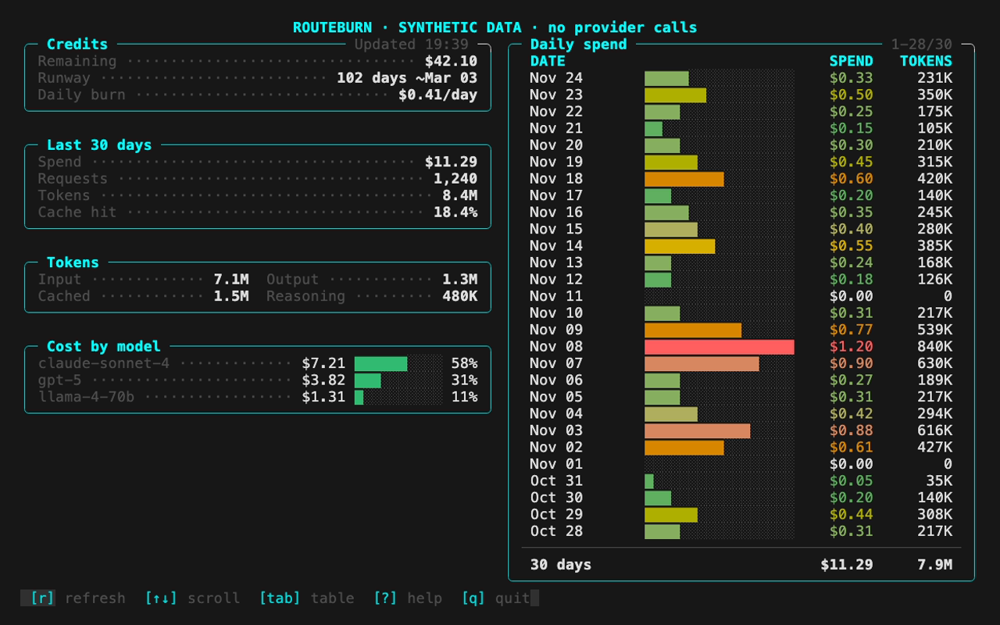

# RouteBurn

**A read-only terminal dashboard for OpenRouter credits, spend, and runway.**

Website: <https://acevedomiguel.github.io/routeburn/>

<p align="center">
  
</p>

Captured from `routeburn demo` with synthetic data; the dashboard shows only your own account figures. Regenerate it with `vhs assets-src/terminal-demo.tape` (see [assets-src/README.md](assets-src/README.md)).

RouteBurn answers three questions without opening a browser: how much credit is
left, what was spent in the last 30 days, and how long that balance lasts at the
current burn rate.

> RouteBurn only reads data. It sends no inference requests, makes no purchases,
> and never rotates or revokes keys.

## Features

- Built on [Charm](https://charm.land) v2 (`charm.land/bubbletea/v2`,
  `charm.land/lipgloss/v2`, `charm.land/bubbles/v2`): the bottom bar is a
  `help` bubble fed by a `key` KeyMap, the refresh indicator is a `spinner`,
  pagination dots come from `paginator`, and the daily table's row window is a
  `table`.
- Full-screen alternate-screen layout with the menu bar pinned to the last row.
- Every section is a bordered panel with its title inlaid in the top border. On
  wide terminals the small panels stack in a left sidebar and the daily table
  takes a full-height right column; the freshness status rides in the Credits
  panel's border.
- Remaining account credit, as a single figure: the purchased total and a
  proportion bar are deliberately not shown.
- 30 daily UTC buckets as a scrollable table: date, spend, tokens, requests,
  and cache hit rate, newest first, with an inline per-day meter heat-coloured
  green-to-red by share of the peak day. `Tab` focuses it (the title inverts),
  `↑↓`/`PgUp`/`PgDn` scroll, and a pinned total row sums the whole window.
- Model spend for the same 30 days, ranked with a short display name, an inline
  proportional meter, and an `Other (remaining)` rollup.
- Runway estimate from the previous 30 complete UTC days of spend.
- Cached snapshot on startup, explicitly labelled with its age when stale.
- Automatic refresh every 10 seconds by default, plus a throttled manual refresh.
  The in-app Settings overlay (`s`) changes the interval to 10s, 30s, 1m, 5m, or
  10m and saves it to the configuration file.
- Replace the management key without leaving the dashboard: the Settings overlay
  validates a new key with one bounded read before storing it, then rebuilds the
  client and refreshes immediately.
- Renders from 60 columns up, and says so plainly when the terminal is smaller.
- Versioned `--json` snapshot for scripts and dashboards.

## Requirements

- Go 1.24 or newer to build from source.
- An OpenRouter **Management API key** for account credits and analytics.
- Optionally a regular **API key**, which adds the `key` section to `--json`.
  `routeburn setup` asks only for the management key; set the regular key through
  `ROUTEBURN_API_KEY` if you want that section.

### Management key versus regular API key

The two keys are not interchangeable, and RouteBurn treats them separately.

| Key | Scope | Used for |
| --- | --- | --- |
| Management key | Whole account | `GET /credits`, `POST /analytics/query` |
| Regular API key | One key | `GET /key` (label, limit, remaining limit) |

A regular key alone cannot show the account balance. A management key alone is
enough for every part of the dashboard; a regular key only enriches the `--json`
contract, because the per-key limit is not shown in the dashboard.
`OPENROUTER_API_KEY` is accepted as a compatibility fallback for the *regular*
key slot only; it is never treated as a management key.

Create a management key at
<https://openrouter.ai/settings/management_keys>.

## Installation

### Homebrew (macOS and Linux)

```bash
brew tap acevedomiguel/routeburn
brew install --cask routeburn
routeburn --version
```

Upgrades arrive through the same tap:

```bash
brew update
brew upgrade --cask routeburn
```

The cask downloads a prebuilt binary rather than compiling from source. That
binary is not notarized by Apple, so the cask clears the macOS quarantine flag
after staging; without that step Gatekeeper would kill the binary on first run.
The tap is a third-party tap, so Homebrew asks you to trust it once:

```bash
brew trust acevedomiguel/routeburn
```

### Go

```bash
go install github.com/acevedomiguel/routeburn/cmd/routeburn@latest
```

### Prebuilt binaries

Every release publishes Linux, macOS, and Windows archives plus a `checksums.txt`
file on the GitHub Releases page. Verify a download with:

```bash
sha256sum -c checksums.txt --ignore-missing
```

### From source

```bash
git clone https://github.com/acevedomiguel/routeburn.git
cd routeburn
make build
./routeburn --version
```

## Built on Burn Blocks

RouteBurn is the terminal UI. The read-only OpenRouter engine it runs on — the
client, snapshot and runway calculation, daily aggregation, cache,
configuration, and credential resolution — lives in
[Burn Blocks](https://github.com/acevedomiguel/burnblocks) as the
`github.com/acevedomiguel/burnblocks/openrouter` package.

RouteBurn imports that package and adds the Bubble Tea dashboard, the `--json`
output, and the `setup`/`logout` commands. The provider contract, the runway
mathematics, and the `openrouter.API` interface for embedding the engine are
documented in [Burn Blocks](https://github.com/acevedomiguel/burnblocks). This
repository no longer publishes a public Go library of its own; its module path
follows the binary's `v1.x.y` releases.

## Quick start

```bash
routeburn setup     # masked prompt, validates the key, stores it, writes config
routeburn           # open the dashboard
```

`setup` never echoes the key, and stores nothing until OpenRouter accepts it. If
you prefer environment variables:

```bash
export ROUTEBURN_MANAGEMENT_KEY="..."
export ROUTEBURN_API_KEY="..."   # optional
routeburn
```

Environment credentials are used as-is and are never copied into persistent
storage automatically.

Replace the management key later without leaving the dashboard: press `s` to
open Settings, choose **Management key**, and enter the new value. It is hidden
as you type, checked with one live read, and stored only after that read
succeeds; the previous key stays in place otherwise. When
`ROUTEBURN_MANAGEMENT_KEY` is set it wins, so the overlay explains that it must
be unset before a key can be stored here.

## Dashboard fields

| Field | Meaning |
| --- | --- |
| Credits remaining | `total_credits - total_usage`. Negative values are shown, never clamped. |
| Last 30 days | Sum of daily credit spend and tokens over the current UTC day plus the 29 before it. |
| Estimated runway | Days until the balance reaches zero at the recent burn rate. |
| Daily spend | One row per UTC day for the 30-day window: spend, tokens, requests, and cache hit rate, with an inline heat-coloured meter per day. |
| Cost by model | Model spend for the window, highest first, top four plus `Other (remaining)`. |
| Tokens | The prompt/completion/cached/reasoning split, from the same analytics query. |

The dashboard does not render the per-key limit: it answers account credit
questions, and a key limit is a separate scope with its own reset cycle. The
section is still present in `--json` when a regular key is configured.

Token counts are not credit balances. The number of tokens a credit buys depends
on the model mix.

### Why every day is a UTC day

RouteBurn buckets and labels days in UTC on purpose, so its numbers match the
OpenRouter dashboard and the API behind it. `POST /analytics/query` returns day
buckets as UTC midnights and has no timezone field; asking for one (or for
`hour` granularity) drops the query off the daily rollups and onto raw
generations, which is capped at 31 days and can return partial values. Local
days would therefore mean different totals from OpenRouter's own figures, so
RouteBurn keeps UTC for the table, the 30-day totals, and the runway window.
Only the runway depletion *date* is rendered in local time, because that is a
calendar calculation rather than an API value.

If you need local-day totals, sum OpenRouter's hourly data yourself; RouteBurn
will not show a number that disagrees with the source it reads.

## Runway formula

```text
daily_burn    = spend over the previous 30 complete UTC days / 30
days_remaining = remaining credits / daily_burn
depletion_date = start of today + ceil(days_remaining) days
```

The window deliberately excludes the current partial day, so a dashboard opened
at 02:00 cannot mistake two hours of spend for a whole day. Days are UTC days,
matching the OpenRouter dashboard — see
[Why every day is a UTC day](#why-every-day-is-a-utc-day). Every branch is
labelled instead of guessed:

| Situation | Displayed |
| --- | --- |
| Balance at or below zero | `0 days`, with a top-up warning when negative |
| No spend in the window | `No recent spend` |
| Analytics unavailable | `Unavailable` |
| Estimate beyond 100 years | `Beyond horizon` (flagged low confidence) |
| Fewer than seven active days | Numeric estimate, flagged low confidence |

Runway is an estimate, not a guarantee. A sudden change in usage invalidates it
immediately. Account runway is also not the same thing as a per-key limit reset.

## Configuration

Locations follow `XDG_CONFIG_HOME` and `XDG_CACHE_HOME` when set (including on
macOS), otherwise the platform defaults:

| Platform | Config | Cache |
| --- | --- | --- |
| Linux | `~/.config/routeburn/config.yaml` | `~/.cache/routeburn/snapshot.json` |
| macOS | `~/Library/Application Support/routeburn/config.yaml` | `~/Library/Caches/routeburn/snapshot.json` |
| Windows | `%AppData%\routeburn\config.yaml` | `%LocalAppData%\routeburn\snapshot.json` |

Print the exact path with `routeburn config path`. A complete configuration file:

```yaml
version: 1
refresh_interval: 10s
range_days: 30
theme: auto
color: auto
keyring: true
```

| Setting | Values | Notes |
| --- | --- | --- |
| `refresh_interval` | `10s` or longer, or `0` | Shorter positive values are rejected. `0` disables automatic refresh only. |
| `range_days` | `30` | Fixed in the MVP. |
| `theme` | `auto`, `dark`, `light` | |
| `color` | `auto`, `always`, `never` | `--no-color` wins over this. |
| `keyring` | `true`, `false` | When `false`, the `0600` fallback file is used. |

Precedence, highest first: CLI flags, environment variables, YAML file,
built-in defaults. Environment variables: `ROUTEBURN_REFRESH_INTERVAL`,
`ROUTEBURN_THEME`, `ROUTEBURN_COLOR`, `ROUTEBURN_KEYRING`,
`ROUTEBURN_MANAGEMENT_KEY`, `ROUTEBURN_API_KEY`, `OPENROUTER_API_KEY`.

The in-app Settings overlay writes only `refresh_interval` back to the active
configuration file (the `--config` path when given) and preserves every other
key; the file stays `0600`. If `--refresh` or `ROUTEBURN_REFRESH_INTERVAL` is
set, that override still wins on the next start, and the overlay says so. A
non-interactive process can always edit the YAML directly.

`routeburn config reset` rewrites the sample configuration.

## Credential storage

Resolution order for the management key:

1. `ROUTEBURN_MANAGEMENT_KEY`.
2. OS keyring (service `routeburn`, account `management`).
3. Fallback file at `0600` inside a `0700` directory.
4. Interactive `routeburn setup`.

The regular API key follows the same chain, with `OPENROUTER_API_KEY` accepted
between the two environment variables.

Storing a key clears the backend it did not use, so a replaced key is not
resolved again: the fallback file is removed before the keyring is written, and
the keyring entry is cleared when the fallback file is the backend that took the
value. If the fallback cannot be cleared, or the keyring is reachable but
refuses to release a stale entry that would shadow the new value, the store
reports a failure instead of a success that would not take effect.

The one exception is `keyring: false`: RouteBurn holds no handle to the keyring
in that mode, so an entry stored there earlier is left untouched and the
fallback file is what resolves. Switching the keyring back on can therefore
surface that older entry. Clear it first — with the keyring enabled, run
`routeburn logout`, or remove the `routeburn` entry in the OS credential store.

A fallback file that is group- or world-readable is refused rather than read,
and the error never prints the secret. `routeburn logout` deletes only
RouteBurn's local keyring entries and fallback files; it does not revoke anything
at OpenRouter, so do that in the OpenRouter console.

## JSON mode

```bash
routeburn --json
```

Prints one snapshot to stdout and exits. Progress, warnings, and errors go to
stderr, so `routeburn --json | jq` is safe. Missing credentials exit `3` with
setup instructions rather than prompting.

```json
{
  "schema_version": 2,
  "generated_at": "2026-11-21T15:42:00Z",
  "cached": false,
  "account": {
    "total_credits": 100,
    "total_usage": 57.9,
    "remaining": 42.1
  },
  "last_30_days": {
    "credit_spend": 12.34,
    "tokens": 8420000,
    "requests": 1240,
    "tokens_prompt": 7100000,
    "tokens_completion": 1320000,
    "cached_tokens": 1512000,
    "reasoning_tokens": 480000,
    "cache_hit_rate": 0.184
  },
  "runway": {
    "window_days": 30,
    "daily_burn": 0.4113,
    "days_remaining": 102,
    "depletion_date": "2027-03-03",
    "basis": "finite",
    "low_confidence": false
  },
  "key": {
    "label": "production",
    "limit": 50,
    "limit_remaining": 31.2,
    "limit_reset": "monthly",
    "usage_monthly": 18.8
  },
  "warnings": []
}
```

`basis` is one of `finite`, `depleted`, `no_recent_spend`, `unavailable`, or
`beyond_horizon`. `key` is `null` when no regular API key is configured, and
`days_remaining`/`depletion_date` are `null` whenever the estimate is not
numeric.

## Offline and cache behaviour

Every successful refresh writes a versioned, atomically replaced snapshot. On the
next launch that snapshot renders immediately and is labelled
`Cached data - updated 2h 14m ago` until a live refresh succeeds. A failed refresh
keeps the previous data on screen with a one-line banner instead of blanking the
dashboard. `--no-cache` skips both reads and writes.

Cached data can be stale. A cached runway estimate is never presented as live.

## Keyboard shortcuts

| Key | Action |
| --- | --- |
| `r` | Refresh now (throttled to one batch per 10 seconds) |
| `s` | Open Settings (refresh interval and management key) |
| `j` / `Down` | Scroll down in the dashboard, or in the Help popup when it is open |
| `k` / `Up` | Scroll up in the dashboard or Help popup |
| `PgDn` / `PgUp` | Scroll one screen |
| `?` | Toggle the Help popup |
| `Esc` | Close the Help or Settings popup, or quit when none is open |
| `q` | Close the Help or Settings popup, or quit when none is open |
| `Ctrl+C` | Quit |

Help opens as a centered, rounded popup above the dashboard. It includes the
full key reference and an **About RouteBurn** section with the current version,
repository, maintainer, and contact information. While Help is open, scrolling
keys affect only the popup and the footer lists the available popup actions.

Settings opens the same way. In it, `↑`/`↓` (or `j`/`k`) pick a row, `←`/`→`
(or `h`/`l`) or a number key 1–5 chooses the refresh interval, and Enter starts a
management-key entry. While typing a key the letters are key content, so only
Enter saves, Esc cancels, and Ctrl+C quits. `Esc`, `q`, or `s` closes Settings
and returns to the dashboard at the same scroll position.

The menu bar on the last row always lists the keys that actually work. The body
is fitted to the frame at every supported size, so scrolling only engages on a
terminal shorter than the 16-row minimum.

When OpenRouter asks RouteBurn to slow down, both automatic and manual refreshes
wait until the requested time has passed and the footer explains why.

## Privacy and security

- No account data leaves the machine: RouteBurn talks only to
  `https://openrouter.ai/api/v1` and writes only to its own config and cache.
- Authorization headers, tokens, and response bodies are never logged, rendered,
  or cached. Error messages are redacted before display.
- TLS is required; a plaintext base URL is rejected unless it points at loopback
  (used by tests).
- The cache stores aggregates only, never credentials or raw responses.

See `SECURITY.md` to report a vulnerability.

## Development

```bash
make check      # gofmt + go vet + go test
make test       # unit tests only
make build      # binary with version metadata
make snapshot   # GoReleaser snapshot build (requires goreleaser)
```

Tests never touch the network, the real keyring, or your real config directory.
Release notes are generated from Conventional Commits; see `CONTRIBUTING.md`.
The screenshot above is an illustration with placeholder values, not a recorded
account.

## Contributing and license

Contributions are welcome under the MIT license in `LICENSE`. Start with
`CONTRIBUTING.md`, and read `CODE_OF_CONDUCT.md` before opening a pull request.
